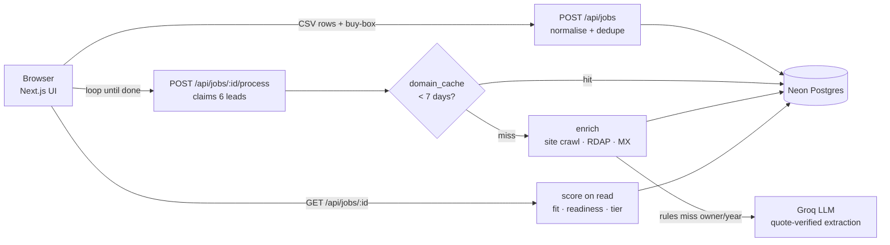

# DealSignal

**Find the owners ready to sell.** DealSignal sits on top of a [SaaSquatch Leads](https://www.saasquatchleads.com/) export and turns a long, half-empty list of companies into a short, ranked, explained shortlist of acquisition targets — with a first message to each owner ready to send.

> Built for the Caprae Capital pre-screening challenge (5-hour build).

**Live demo:** https://dealsignal-bay.vercel.app (click **"Use the sample"** to try it without a file)

## The problem

SaaSquatch's users are **searchers**: people looking to buy and run one small business. A search returns hundreds or thousands of companies. Studying SaaSquatch's own demo videos showed where that leaves a searcher:

| What we saw | Why it hurts |
|---|---|
| 1,000+ results, no ranking | A searcher can only call a handful of owners a day |
| Revenue, BBB, employees, year founded mostly `N/A` | No way to tell a $1M shop from a $20M one |
| Revenue estimates tagged "Low confidence", no method | Hard to trust |
| "AI Company Scoring" listed but never explained | Black box |
| Nothing about *who might sell* | The one question a searcher actually has |
| Email generator needs 3 × 20-word context pasted by hand | Slow |

## What DealSignal does

1. **Upload** a SaaSquatch CSV (any CSV with a company column works — headers are auto-mapped).
2. **Set a buy-box**: industries, states, revenue band, minimum years in business.
3. **Clean**: normalises domains and phone numbers, merges duplicates (same website, or same name + city), and counts locations when one website appears in several cities.
4. **Check every website** (≤5 pages: home, about, team, careers, contact) and domain records.
5. **Score** each company on two axes, with the reason for every point:
   - **Fit** — does it match the buy-box?
   - **Ready to sell** — public signals that an owner may be open to a conversation.
6. **Rank** into Tier A (call first), B, C, and Dropped (dead website).
7. **Write an opener** for any lead, built on one verified fact.
8. **Export** a full CSV or a HubSpot company-import CSV.

Changing the buy-box re-ranks the list instantly — scores are recomputed from stored signals, nothing is re-crawled.

### Seller-readiness signals

| Signal | Points | Where it comes from |
|---|---|---|
| 20+ years in business (10–19: +12) | +25 | "Since 1986", "over 40 years", or the list's Year Founded |
| Family / owner-operated | +20 | Site wording |
| Owner identified | +10 | Site text ("our founder, Greg Coward…") |
| Runs on the owner personally | +10 | "Call me directly", "I personally…" |
| Single location | +10 | Not multi-location on the site or in the list |
| Not hiring | +10 | No careers page / "now hiring" |
| Website not updated in 3+ years | +15 | Footer copyright year |

Every signal is stored with the **URL and the quote** it came from, shown in the lead drawer. Nothing is inferred about an owner's age or health.

### Revenue — with the math shown

`headcount × revenue per employee for the industry (US Census, Statistics of US Businesses 2022) ± 30%`, e.g. *20 technicians × $260k (Plumbing, Heating & AC Contractors) ≈ $3.6M–$6.8M*.

Headcount comes from the strongest evidence available, in order:
1. A stated number on the site ("our 20 technicians", "a team of 25")
2. The list's Employees Count column (SaaSquatch fills this from Apollo/Growjo)
3. People named on the team page — a heading counts only if its first word is a real first name (SSA list), so "Hugo Sanchez" counts and "Roof Repair" does not
4. Fleet size ("12 service trucks" → ~18 staff)

With no company-specific evidence, the app shows what a **typical** small firm in that industry earns (Census: average of firms under 20 staff → average of firms with 10–19 staff, × locations). It is shown greyed and labelled *industry typical*, earns only half the buy-box points, and is never exported to HubSpot as the company's revenue. See [`data/README.md`](data/README.md).

## Results on the sample list

`public/sample-saasquatch-dfw.csv` — 106 real Dallas–Fort Worth home-service businesses in SaaSquatch's export format (from OpenStreetMap; see [`data/README.md`](data/README.md)). Numbers are from one run; they shift slightly between runs because live websites go up and down, and when the free AI tier is busy a few companies are filled in on the next run instead.

| | |
|---|---|
| Rows uploaded | 106 |
| Unique companies after merging duplicates | 88 |
| Dead websites dropped | 6 |
| Tier A / B / C | 23 / 24 / 35 |
| Year founded known | 11% → 48% |
| Owner name known | 0% → 16% |
| Contact email known | 0% → 24% |
| Revenue from the company's own headcount | 0% → 9% (the rest get a labelled industry-typical range) |
| Time (cold, 88 sites) | ~3 min · re-runs are instant from cache |

## Architecture



| Layer | Choice | Why |
|---|---|---|
| Framework | **Next.js 15** (App Router, TypeScript, Tailwind CSS 4) | One codebase for UI + API routes |
| Hosting | **Vercel**, serverless functions (Node.js runtime), static assets on the CDN | Zero-ops, preview deploys |
| Cloud | Vercel on **AWS** (us-east-1), database on **AWS us-east-1** via Neon | App and DB in the same region |
| Database | **Neon Postgres** (serverless), `@neondatabase/serverless` HTTP driver | No connection pool to manage from serverless functions |
| Queue | None — the browser calls `/process` in a loop; leads are claimed with `UPDATE … FOR UPDATE SKIP LOCKED` | No worker or cron needed; safe if two tabs run at once; stuck leads are re-claimed after 2 min |
| Caching | `domain_cache` table, 7-day TTL, shared across uploads | Re-running or overlapping lists never hit the same site twice |
| Rate limiting | `rate_limits` table, fixed one-hour windows per visitor | Works across serverless instances without adding a cache service |
| Scores | Computed on read, not stored | Buy-box edits re-rank instantly |
| Scraping | `fetch` + `cheerio`, 8 s timeouts, ≤5 pages per site, 6 sites in parallel | Small and fast |
| AI | **Groq** free tier (`openai/gpt-oss-20b`, falls back to `qwen/qwen3.8-27b`, `openai/gpt-oss-120b` when rate-limited) | Fast inference; rotating models multiplies the free per-model token budget |
| CSV | `papaparse` | Robust parsing and export |

### Accuracy and data quality

- **Rules first, AI second.** Regex rules extract founding year, ownership, owner name, employees, hiring and copyright year. The LLM only runs when rules miss the owner or founding year.
- **No hallucinated facts.** An AI-extracted owner name, year or headcount is kept only if it appears verbatim in the page text, and the quote is stored as evidence.
- **Moved sites.** If a domain now redirects to a different business (sold, parked, rebranded into something else), that site's facts are not used and the lead is flagged; a move to a domain carrying the same name is treated as the same business.
- **Shared hosts.** A Facebook, Yelp or Google listing given as the "website" is never used to merge leads or crawled as the company's site.
- **Dead vs blocked.** A site that does not resolve or refuses connections is *dropped*. A site behind bot protection (HTTP 401/403/429/503) is *kept* and flagged "verify manually" — it is not treated as closed.
- **Deduplication** by website domain, falling back to normalised name + city.

### Ethical collection

- Identifies itself honestly (`DealSignalBot/0.1`) and respects `robots.txt`.
- Reads only a company's own public website and public domain records (RDAP registration date, DNS MX).
- Does **not** scrape LinkedIn, solve CAPTCHAs, rotate IPs or spoof a browser to get past bot protection.
- If `robots.txt` disallows the homepage, nothing from the site is used and the lead is flagged "verify manually".

### Security

- **No SSRF.** Uploaded lists are untrusted, so every fetch (and every redirect hop, followed manually) is refused unless the host is a public domain name resolving only to public IPs — no IP literals, `localhost`, private ranges or cloud metadata addresses.
- **Safe exports.** CSV cells that start with `=`, `+`, `-` or `@` are escaped, so scraped text can't run as a spreadsheet formula.
- **Per-visitor limits.** Each visitor can create 10 lists and write 30 openers per hour (counted in Postgres, since serverless instances share no memory), so a public demo link can't drain the free AI quota or be used to crawl the web at scale.
- **Openers always answer.** One 90-second budget covers every retry and rate-limit wait, so the request ends with an opener or a clear "try again" well before the platform's time limit.
- **Bounded work.** Pages are read up to 1.5 MB, one batch runs per job at a time, and openers are only reachable through their job's id.
- **One bad site can't stall a list.** A crash while checking one company is logged and that lead is scored on its CSV data alone.
- Inputs are validated at the API boundary (row cap, buy-box sanitising, id formats). Results are reachable only through their unguessable job link; there are no user accounts in this prototype.
- Openers never speculate about an owner's age, health or retirement.

## Run it locally

Requirements: Node 20+, a free [Neon](https://neon.tech) database, and a free [Groq](https://console.groq.com) API key (optional — without it, scoring still works and openers are disabled).

```bash
npm install
cp .env.example .env.local   # fill in GROQ_API_KEY, DATABASE_URL, DATABASE_URL_UNPOOLED
npm run db:migrate           # creates the tables
npm run dev                  # http://localhost:3000
npm test                     # normalisation, extraction, scoring, opener and address-filter tests
```

Click **"Use the sample"** on the home page to try it without a file.

## Deploy

```bash
npx vercel link
npx vercel env add GROQ_API_KEY production
npx vercel env add GROQ_MODEL production      # optional, defaults to openai/gpt-oss-20b
npx vercel env add DATABASE_URL production
npx vercel --prod
```

`vercel.json` pins the framework to Next.js, and `.vercelignore` keeps `.env*` files and local build output out of the upload. Run `npm run db:migrate` once against the production database before the first deploy.

## Project layout

```
app/
  page.tsx                    upload + buy-box
  sheet.tsx                   home-page "marked-up list" built from a real run
  ui.tsx                      shared bits: tier badge, score bar, chips, buy-box form
  theme-toggle.tsx            light/dark switch (follows the device by default)
  jobs/[id]/page.tsx          ranked results, filters, exports
  jobs/[id]/drawer.tsx        evidence + opener for one lead
  api/jobs/…                  create, read, re-rank, process, export
  api/jobs/[id]/leads/[leadId]/opener   AI opener (scoped to its job)
lib/
  normalize.ts                column mapping, cleaning, dedupe
  enrich.ts                   website + domain signals
  score.ts                    fit, readiness, revenue, tiers
  jobs.ts                     storage + batch worker
  groq.ts, opener.ts          LLM client and prompt
  ratelimit.ts                per-visitor hourly limits
db/schema.sql                 jobs, leads, domain_cache, rate_limits
data/                         Census revenue benchmarks + provenance
scripts/                      sample-list builder, migration
```

## Limitations and next steps

- **Company-specific revenue needs headcount.** Small trade businesses rarely publish it (9% of the sample). Real SaaSquatch exports carry Apollo/Growjo employee counts, so far more rows get a company-specific range.
- Signals are public and indirect — they rank who to call first, they don't predict a sale.
- Next: state business-registry lookups (officers, entity age, active status) to reach owner-run businesses that data vendors miss; direct HubSpot API sync; scheduled re-checks to catch changes such as a site going stale or a "for sale" notice.
